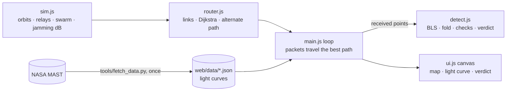

# AstroRoute — keep the signal alive, find the world

**Theme:** SPACE · Exoplanet Hunter. **Constraint (given at 12:00):** when asteroids or comets
disrupt the radio signals between Earth and the target system, the solution must dynamically find
an alternative transmission path to keep communication up and enable exoplanet detection.
**No pre-built models.** Build window 12:00 → 14:30, then pitch.

## The product in one breath
A deep-space observatory watches a star and streams its light curve to Earth through a network of
relays. An asteroid/comet swarm drifts through the network and jams links. **Our router** finds the
best path and an **independent alternate path**, and reroutes live as the swarm moves. Every packet
that arrives feeds **our from-scratch BLS detector**, so the audience watches the planet's transit
emerge from the data *while* the network fights the swarm. Verdict + physics checks explain why.

- Everything we wrote ourselves: router (Dijkstra + disjoint alternate), link/jamming model,
  BLS detector, vetting checks. **No ML, no trained model, no routing/BLS library.**
- Libraries used only for data access: `lightkurve` (download NASA light curves, offline, once).
- Runs in any browser, no build step, hosted on GitHub Pages.

## Wow numbers (measured today, never before)
1. Router optimal vs brute force on N random networks — **0 mismatches** (test).
2. Packets delivered during a swarm: **with rerouting X% vs fixed route Y%** (headless sim).
3. Our BLS recovers **A of B** NASA-published periods within 1% (validation).

## Scoring → what we show
| Criterion | Pts | Show |
|---|---|---|
| Functionality | 30 | live map: swarm jams a link → reroute in real time → packets keep flowing → transit appears → verdict. Tests + numbers. |
| Relevance | 10 | exactly the constraint: disruption → alternative path → detection still completes |
| Innovation | 6 | detection *during* transmission; independent alternate path pre-computed (instant failover); from-scratch BLS |
| Polish | 4 | one dark theme, accent `#7FD1FF`, smooth animation, no console errors |

## Roles
| Person | Gauntlet | Owns |
|---|---|---|
| **Chirag** (bench, all 2.5 h) | — | `web/js/router.js`, `tests/router.test.mjs`, `tools/fetch_data.py`, integration, hosting |
| Abhijeet (`thegoodengineer`) | Debugger | `web/js/detect.js`, `tests/detect.test.mjs` |
| Ayush (`AyushVUpadhye`) | UI/UX | `web/index.html`, `web/css/style.css`, `web/js/ui.js`, `web/js/main.js` |
| Bhumika (`Bhumika-1432006`) | AI Music | `web/js/sim.js`, `tests/sim.test.mjs`, `tools/validate.mjs`, README, slides, form |

Everyone edits ONLY their files. Task details: `docs/tasks/TASK_<NAME>.md`.

## Timeline
| Time | What |
|---|---|
| 12:10 | everyone cloned, AI working on their task file |
| 12:10–13:15 | build modules against the interfaces below; tests green; small PRs, self-merge |
| 13:15–13:45 | integrate in `main.js`; real data in `web/data/`; `?demo=1` story |
| 13:45–14:00 | measure the 3 wow numbers; Pages live |
| **14:00** | **FREEZE.** Slides + 2 rehearsals |
| 14:30 | pitch (all four). After: demo video, ZIP, form |

## Architecture

## Interfaces (ES modules in `web/js/`, units: AU, days, minutes, dB)
**sim.js** (Bhumika)
- `createWorld(scenario = "default") -> world`
- `step(world, dtHours)` — planets on circular orbits, relays, debris drift (asteroids slow, comets fast)
- `snapshot(world) -> { t, nodes: [{id, name, kind: "earth"|"relay"|"observatory", x, y}],
  debris: [{id, kind: "asteroid"|"comet", x, y, r, strength, vx, vy}] }`
- `attenuationDb(snap, nodeA, nodeB) -> number` — jamming along segment A–B: for each debris,
  closest distance s from its centre to the segment; if s < r add `strength * (1 - s/r)^2` dB.
- `addDebris(world, x, y, kind)` — user drops a swarm/comet.

**router.js** (Chirag)
- `buildLinks(snap, attenuationDb, opts) -> [{a, b, distAU, latencyMin, snrDb, blocked}]`
  latencyMin = distAU × 8.317 (light-minutes per AU); snrDb = txDb − 20·log10(distAU) − jamming;
  blocked if snrDb < thresholdDb or distAU > maxRangeAU.
- `bestPath(links, src, dst, mode = "fastest"|"reliable") -> {nodes, latencyMin, minSnrDb, cost} | null`
  fastest: cost = latency; reliable: cost = latency + λ·max(0, comfortDb − snrDb).
- `alternatePath(links, src, dst, best, mode) -> {...route, independent} | null`
  shortest path sharing no intermediate node with `best` (independent = true); if none exists,
  the best path that differs by at least one link (independent = false).

**detect.js** (Abhijeet)
- `bls(time, flux, opts) -> {periods, power, best: {period, t0, duration, depth, depthErr, snr}}`
- `fold(time, flux, period, t0) -> {phase, flux}`
- `vet(time, flux, best) -> {checks: [{name, passed, value, detail}], verdict}`
  verdicts: `"PLANET CANDIDATE" | "LIKELY FALSE POSITIVE" | "NO CONVINCING SIGNAL" | "NEED MORE DATA"`

**data file** `web/data/<slug>.json` (Chirag): `{target, mission, publishedPeriod, kind:
"planet"|"false_positive"|"candidate", time: [...], flux: [...]}` — flattened, normalised, ≤ 6000 points.

## Simplifications we say out loud (Q&A honesty)
2-D solar system, circular orbits, toy link budget (tx power, 1/d² loss, jamming dB), debris as
jamming discs. Light curves are real NASA data replayed as packets. The point is the routing logic
and detection under disruption, not RF-engineering accuracy.

## Git flow
Clone `https://github.com/thegoodengineers/astroroute`, branch `feat/<area>`, small PRs titled
"<issue> (closes #N)", **squash-merge yourself** when your "Done when" passes. `git pull origin main`
before each PR. Before a Gauntlet: commit, push, merge, tell Chirag. Run locally:
`python -m http.server 8000 -d web` → http://localhost:8000 (ES modules need http, not file://).
Tests: `node --test "tests/*.test.mjs"` (or `npm test`).

## Submissions
Drive: UI/UX ZIP+MP4 (Ayush, in Gauntlet) · Music MP4 (Bhumika, in Gauntlet) · source ZIP + demo MP4
(Chirag, after pitch). Form: GitHub link, demo video link, description + stack, hosted link (Pages).
